# Case for Google AIY Voice Kit v2

**English** | [繁體中文](README.zh-TW.md)

A 3D-printable replacement for the cardboard box of the **Google AIY Voice Kit v2**
(Raspberry Pi Zero W + Voice Bonnet + speaker + arcade button). Modeled in Python with
[build123d](https://github.com/gumyr/build123d), so every dimension can be changed in code.

**Download:** [MakerWorld](https://makerworld.com/en/models/3601164) · [Printables](https://www.printables.com/model/1912280) · [GitHub Release](https://github.com/YongRui0402/aiy-voice-kit-v2-case/releases/latest)

<p>
  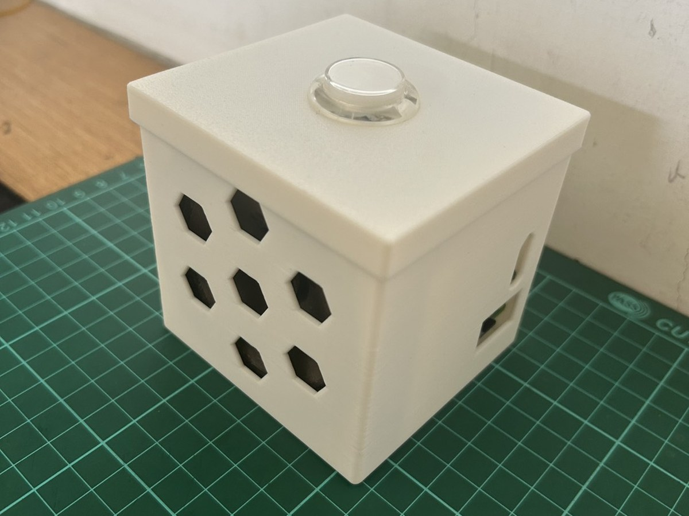
  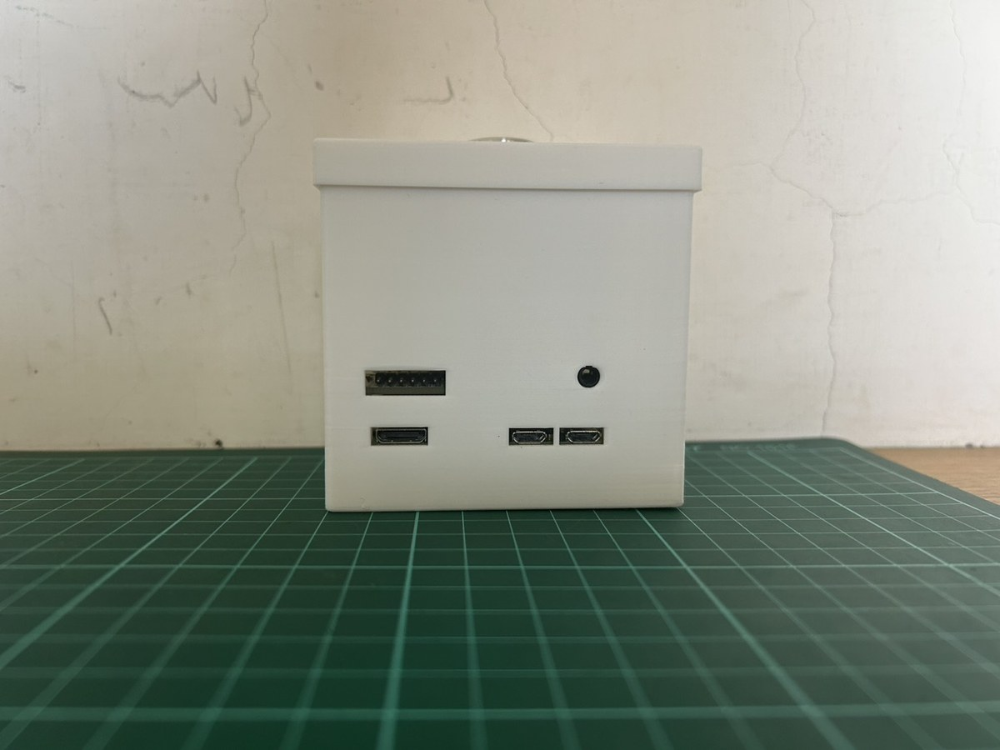
  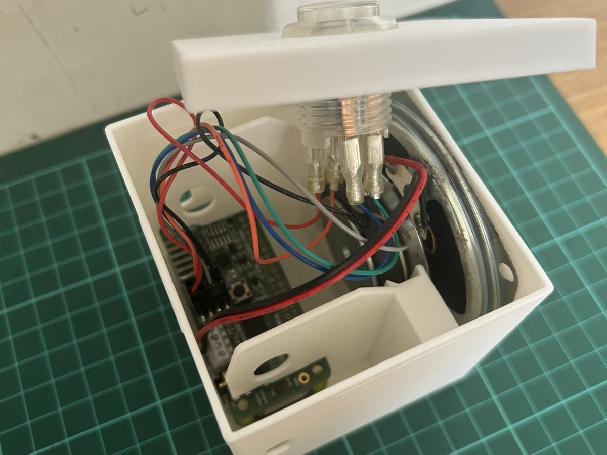
</p>

Printed in white PLA. Renders of the three parts and how they fit together:

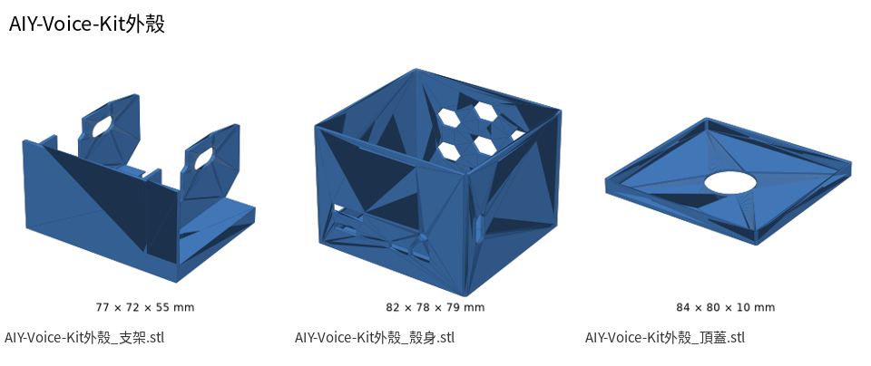
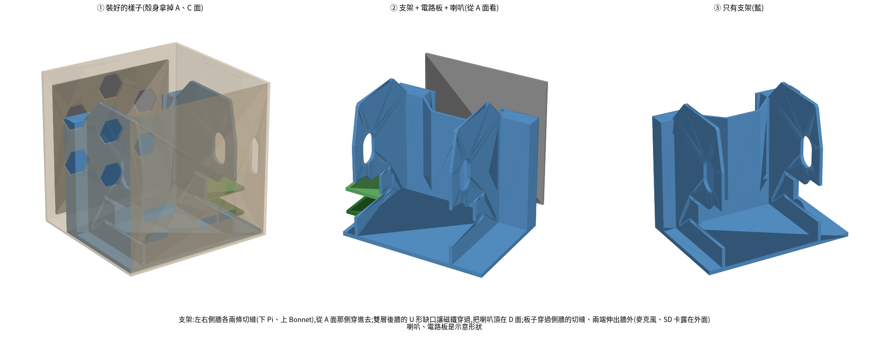

> **Unofficial.** This project is not affiliated with or endorsed by Google.
> "Google" and "AIY" are trademarks of Google LLC and are used here only to describe compatibility.

## Parts

| File | Size (mm) | Print orientation |
|---|---|---|
| `models/aiy-voice-kit-v2-case_body.stl` | 82.4 × 77.9 × 79.0 | Bottom on the bed, opening up |
| `models/aiy-voice-kit-v2-case_lid.stl` | 84.1 × 79.6 × 9.6 | Upside down (top face on the bed) |
| `models/aiy-voice-kit-v2-case_holder.stl` | 77.0 × 71.9 × 55.4 | Standing on its back wall (the large flat face with the U-shaped notch). **The STL is already in this orientation — do not let the slicer auto-orient it.** |

STEP files for every part, plus a full assembly (`_assembly.step`) and an exploded view
(`_assembly_exploded.step`) with dummy boards and speaker, are in `models/`.

## Printing

- Tested on a Bambu Lab X2D, PLA, 0.20 mm layer height, **no supports**.
- Heights are multiples of 0.2 mm; other layer heights work but may round some features.
- Two small bridges (holder side-wall hole, body SD-card opening) are slightly over the
  usual bridge limit; they printed cleanly in testing.

## Assembly

1. Slide the Pi Zero W (lower) and the Voice Bonnet (upper) into the slots in the holder's
   side walls from the connector side. Board ends (microphones, SD card) stick out of the walls, just like the cardboard frame.
2. Drop the speaker into the holder's double back wall: the outer notch holds the speaker neck, the magnet sits between the two walls.
3. Slide the holder into the body.
4. Mount the arcade button in the lid, connect it, and press the lid on (snap fit).

## Photos

<table>
  <tr><td width="33%"><br><sub>Assembled</sub></td><td width="33%">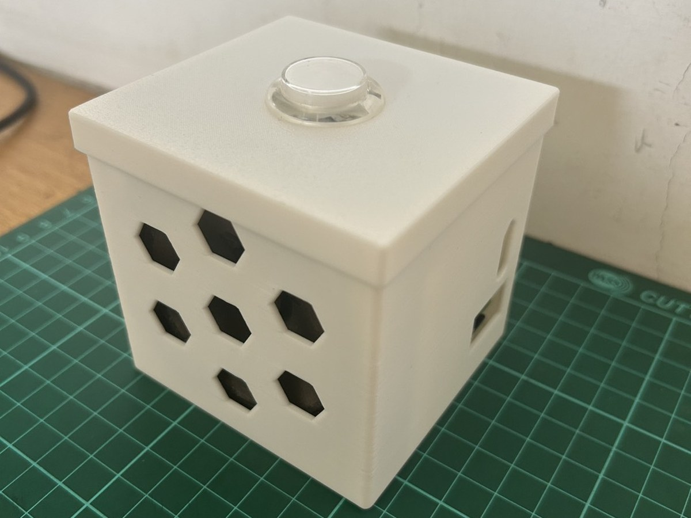<br><sub>Assembled, another angle</sub></td><td width="33%">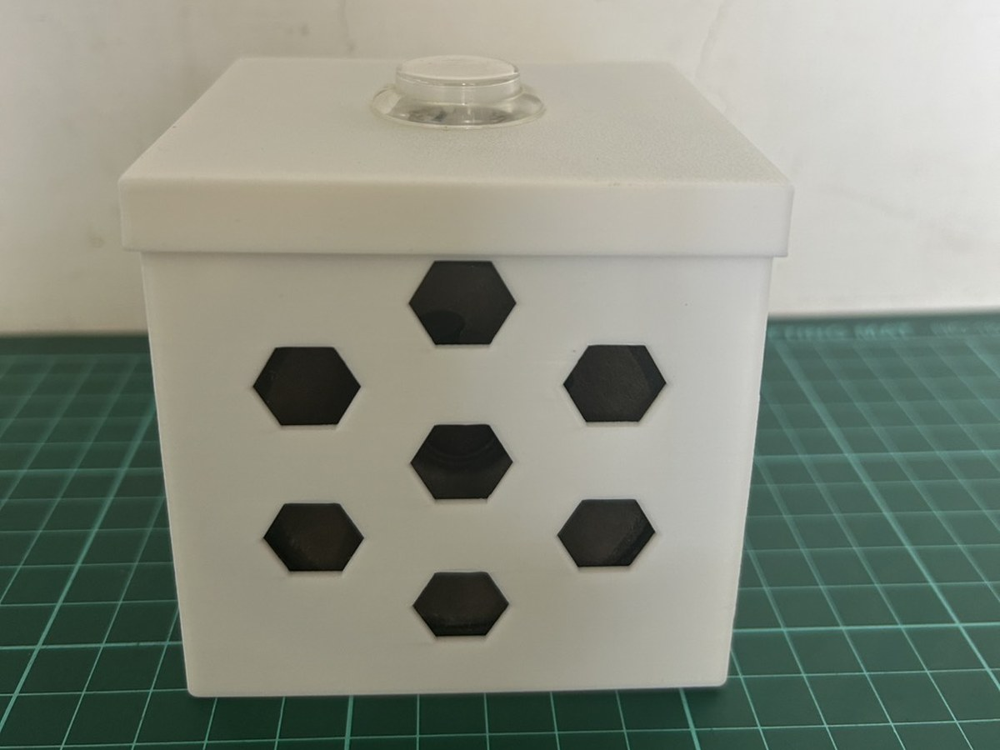<br><sub>Speaker side</sub></td></tr>
  <tr><td width="33%"><br><sub>Port side (GPIO, USB, audio)</sub></td><td width="33%">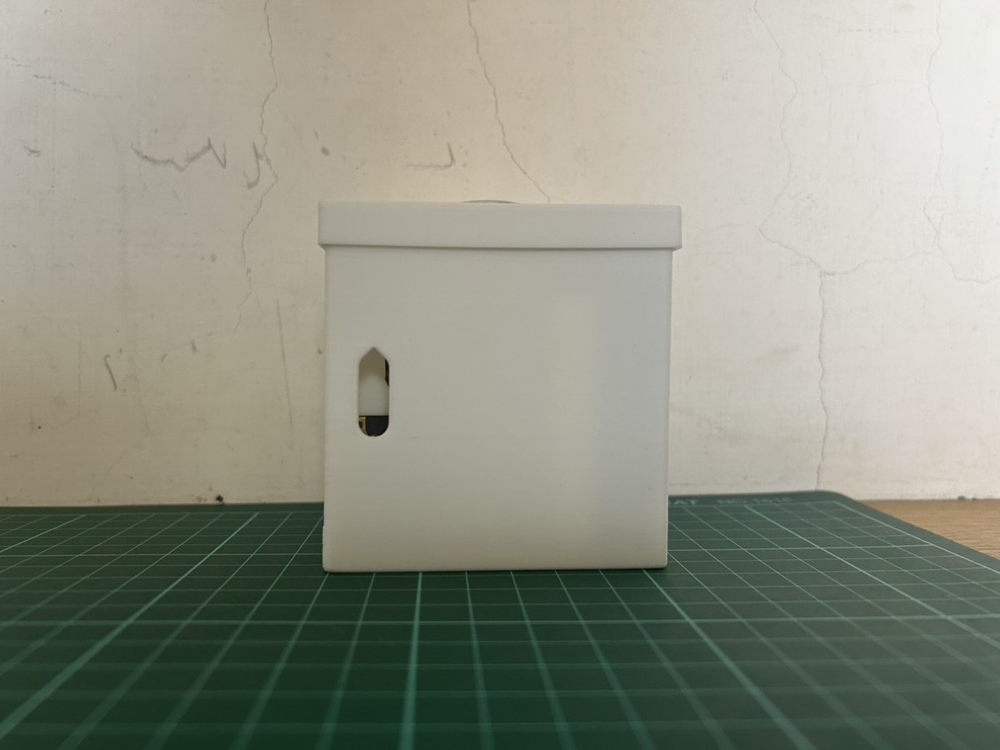<br><sub>Side with microphone slot</sub></td><td width="33%">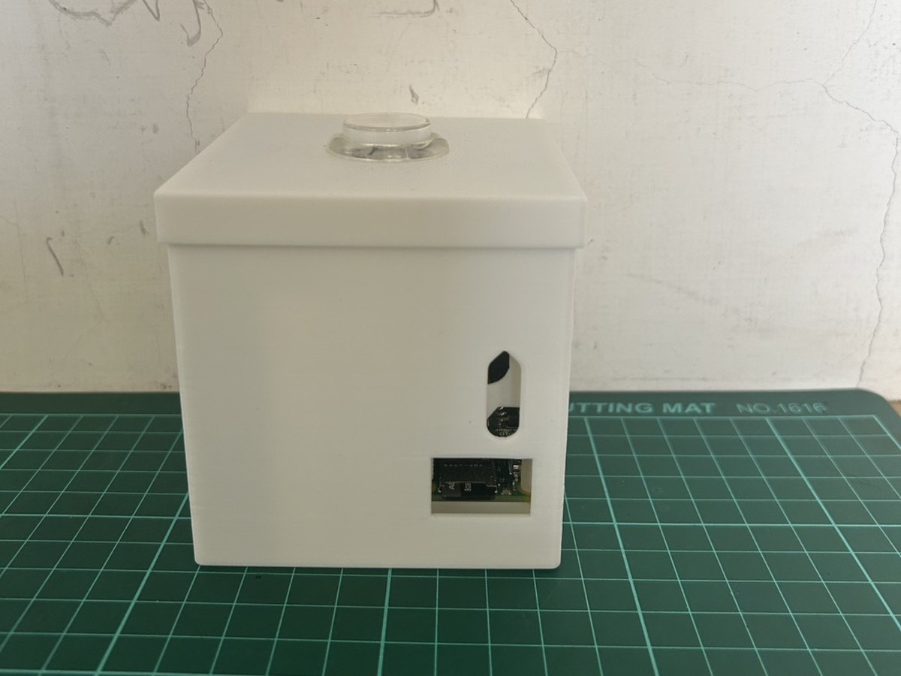<br><sub>Side with microphone slot and SD card</sub></td></tr>
  <tr><td width="33%"><br><sub>Inside, lid open</sub></td><td width="33%">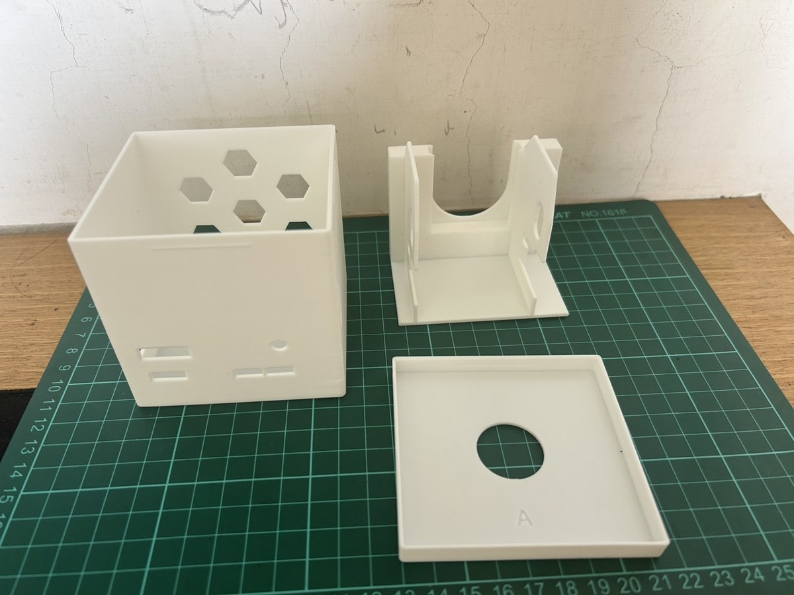<br><sub>The three parts</sub></td><td width="33%">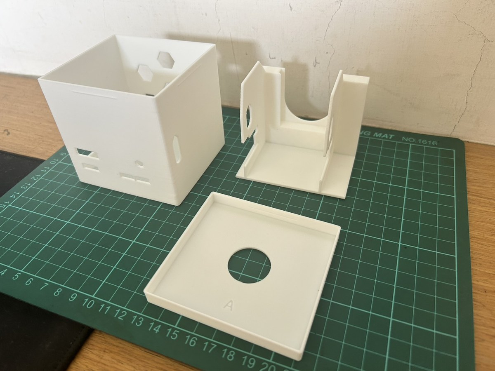<br><sub>The three parts, another angle</sub></td></tr>
  <tr><td width="33%">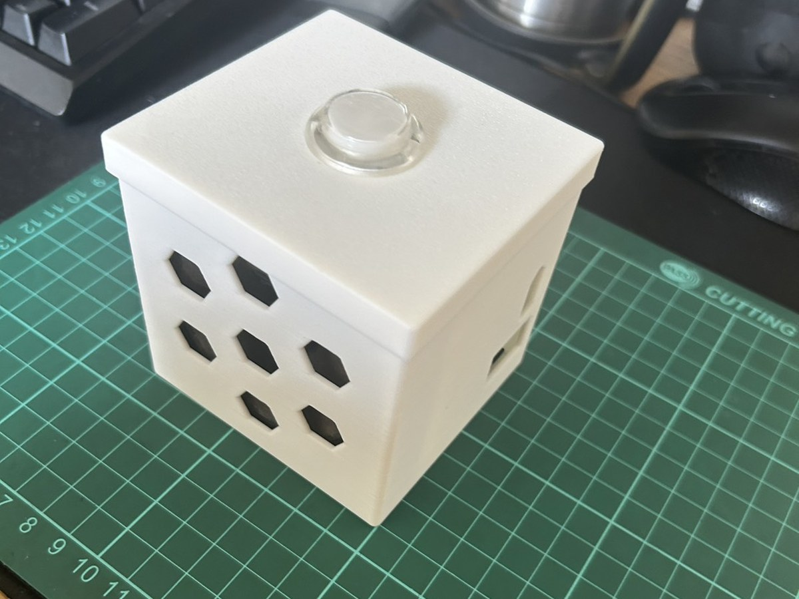<br><sub>On the desk</sub></td><td width="33%">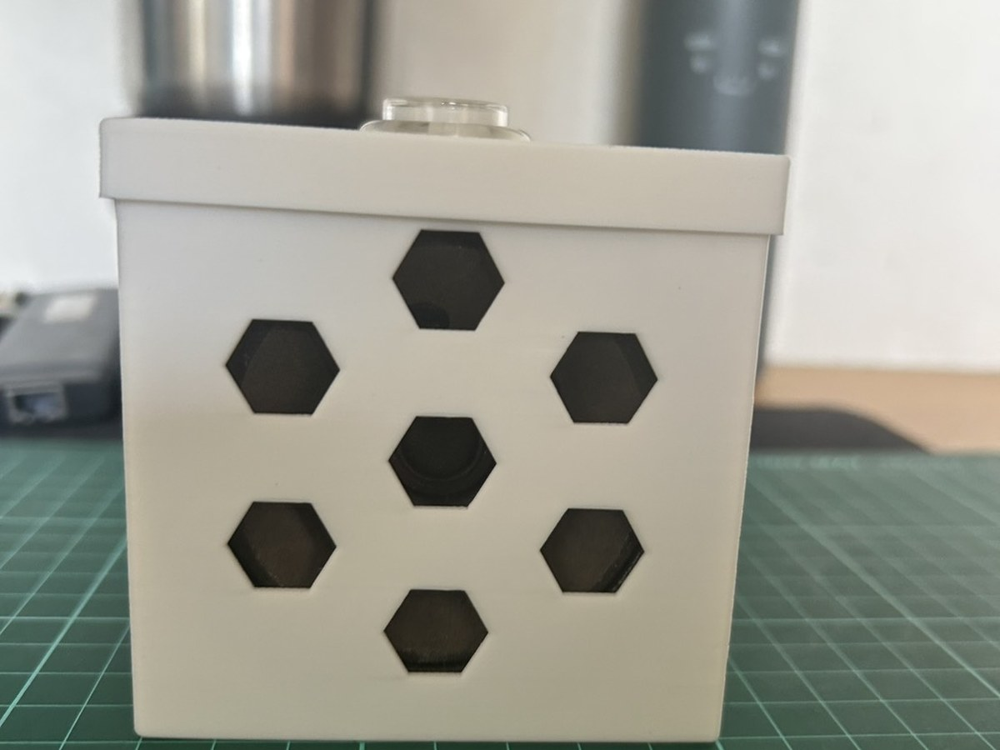<br><sub>Speaker side, on the desk</sub></td></tr>
</table>

## Fit and tolerances

Measured from the original kit's cardboard and tuned on one printer. If your printer prints
holes or outlines differently, adjust these constants in `src/aiy_case.py`:

- `HOLE_GRIP` — extra size added to every opening (default 0.2 mm).
- `LID_GAP_VARIANTS` — lid fit. Variant **A** (0.0 mm) is the tested, released lid.
  Variant **B** (0.3 mm) is looser and **untested**; try it if A is too tight on your printer.

## Rebuild / modify

Requires [uv](https://docs.astral.sh/uv/) (Python 3.11–3.14).

```sh
uv run python src/aiy_case.py      # body + lid A/B  -> src/build/
uv run python src/aiy_holder.py    # holder          -> src/build/
uv run python src/assembly.py      # assembly STEPs  -> src/build/
```

With `build123d==0.13.0` (pinned in `uv.lock`), the rebuilt STLs are byte-identical to the
ones in `models/`. Source comments are in Traditional Chinese; each constant notes where its value came from.

## License

| What | License |
|---|---|
| Code (`src/`, `pyproject.toml`) | [MIT](LICENSE) |
| Models (`models/`), images (`docs/`) and this README | [CC BY 4.0](LICENSE-CC-BY-4.0.txt) |

You may print, sell prints, remix and redistribute, as long as you give credit
(e.g. "Case for AIY Voice Kit v2 by YongRui0402" with a link to this repository).

