# Google AIY Voice Kit v2 外殼

[English](README.md) | **繁體中文**

取代 **Google AIY Voice Kit v2**(Raspberry Pi Zero W + Voice Bonnet + 喇叭 + 大按鈕)原廠紙盒的 3D 列印外殼。
以 Python 的 [build123d](https://github.com/gumyr/build123d) 建模,所有尺寸都能在程式裡修改。

**下載:** [MakerWorld](https://makerworld.com/en/models/3601164) · [Printables](https://www.printables.com/model/1912280) · [GitHub Release](https://github.com/YongRui0402/aiy-voice-kit-v2-case/releases/latest)

<p>
  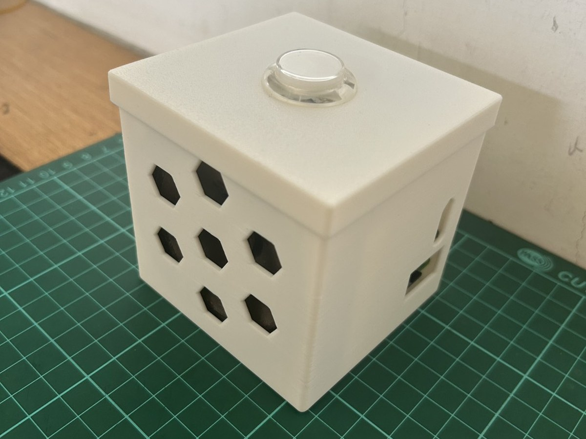
  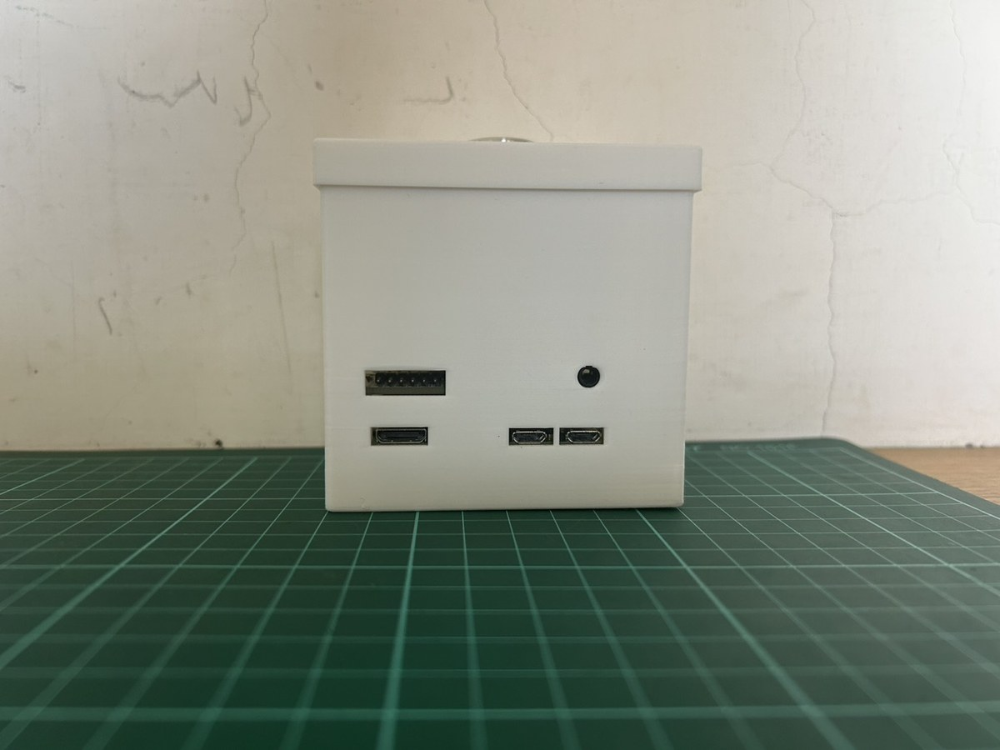
  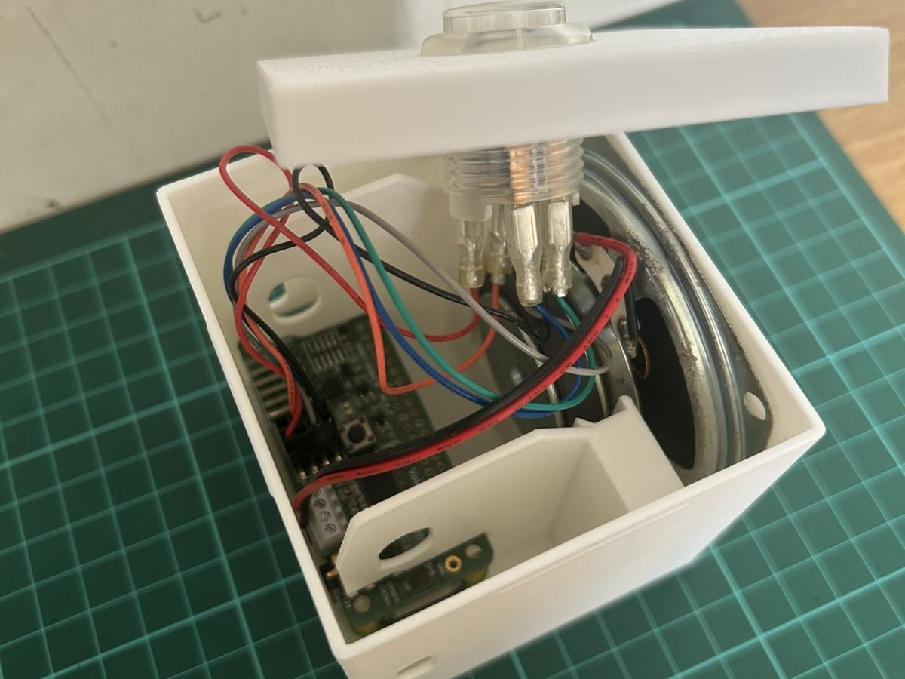
</p>

白色 PLA 實際列印。下面是三個零件的渲染圖,以及它們怎麼組在一起:

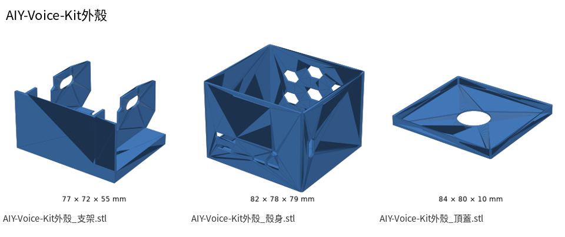
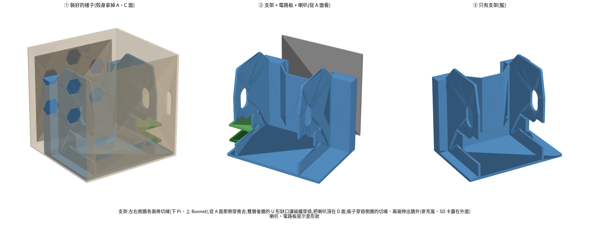

> **非官方專案。** 本專案與 Google 無關,也未經 Google 認可。
> 「Google」與「AIY」是 Google LLC 的商標,這裡只用來說明相容的套件。

## 零件

| 檔案 | 尺寸 (mm) | 列印擺法 |
|---|---|---|
| `models/aiy-voice-kit-v2-case_body.stl`(殼身) | 82.4 × 77.9 × 79.0 | 底面貼熱床、開口朝上 |
| `models/aiy-voice-kit-v2-case_lid.stl`(頂蓋) | 84.1 × 79.6 × 9.6 | 倒過來印(頂面貼熱床) |
| `models/aiy-voice-kit-v2-case_holder.stl`(支架) | 77.0 × 71.9 × 55.4 | 後牆(有 U 形缺口的大平面)貼熱床、立著印。**STL 已經是這個擺法,切片時不要讓切片軟體自動調整方向。** |

`models/` 裡還有每個零件的 STEP,以及整組組裝(`_assembly.step`)與爆炸圖(`_assembly_exploded.step`),內含示意用的電路板與喇叭。

## 列印

- 在 Bambu Lab X2D 上試印過:PLA、層高 0.20 mm、**不加支撐**。
- 高度都是 0.2 mm 的倍數;用其他層高也能印,但部分細節可能會被進位。
- 有兩處小橋接(支架側牆的橢圓孔、殼身的 SD 卡開口)略超過一般的橋接上限,試印時沒有下垂。

## 組裝

1. 從接頭那一側,把 Pi Zero W(下層)和 Voice Bonnet(上層)推進支架側牆的切縫。板子兩端(麥克風、SD 卡)會伸出牆外,和原廠紙架一樣。
2. 把喇叭放進支架的雙層後牆:外層缺口卡住喇叭頸部,磁鐵夾在兩層之間。
3. 把支架推進殼身。
4. 把大按鈕鎖在頂蓋上、接好線,壓上頂蓋(卡扣)。

## 照片

<table>
  <tr><td width="33%"><br><sub>組好的外殼</sub></td><td width="33%">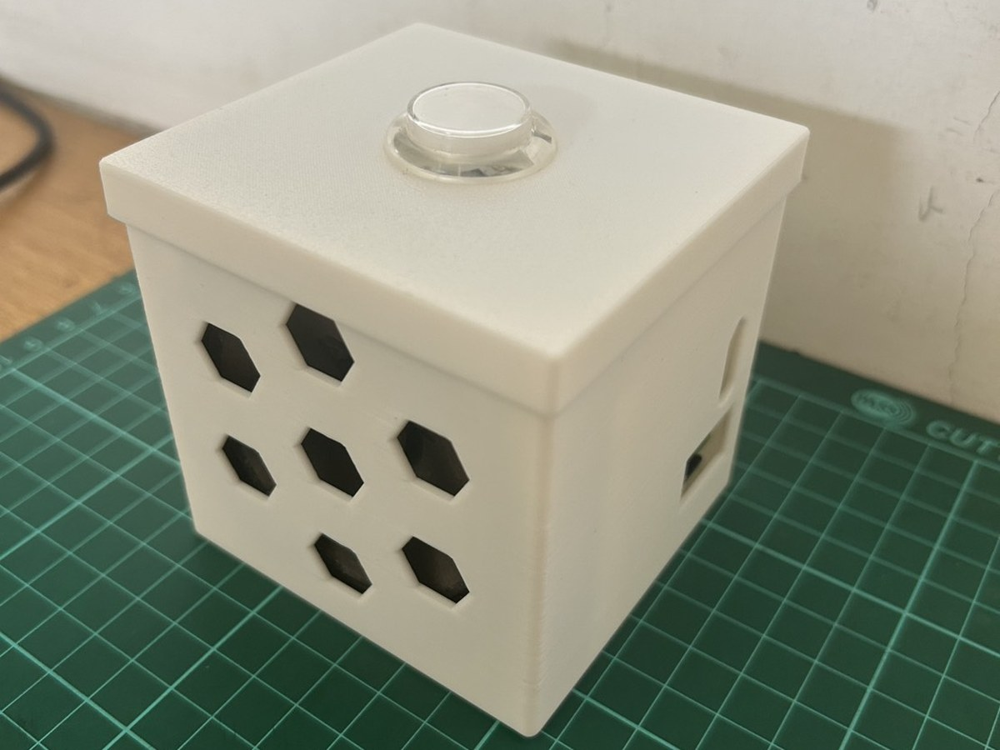<br><sub>組好的外殼,另一個角度</sub></td><td width="33%">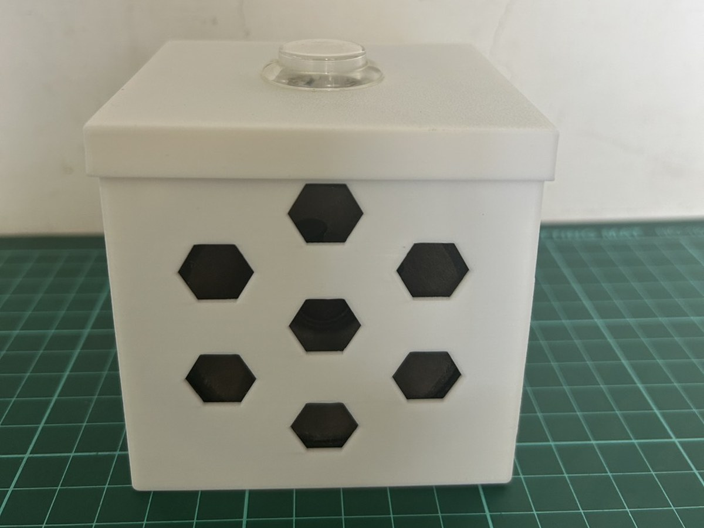<br><sub>喇叭面</sub></td></tr>
  <tr><td width="33%"><br><sub>接頭面(GPIO、USB、音源)</sub></td><td width="33%">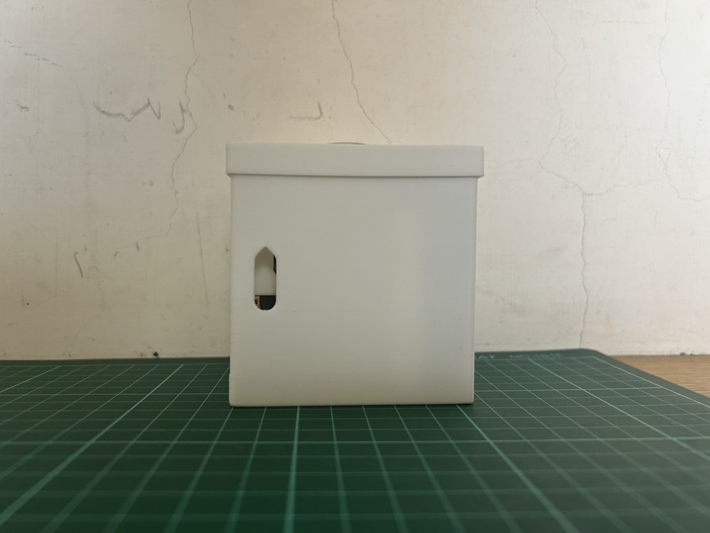<br><sub>側面麥克風長孔</sub></td><td width="33%">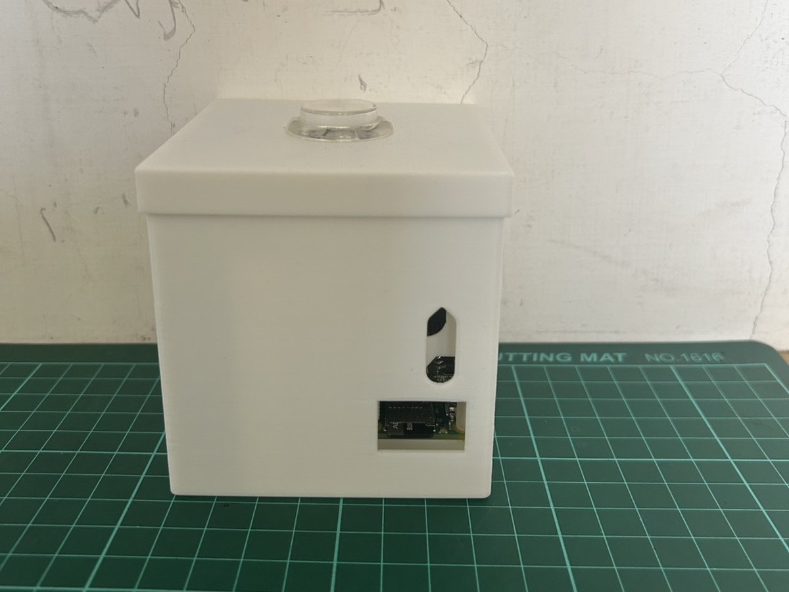<br><sub>另一側:麥克風孔與 SD 卡</sub></td></tr>
  <tr><td width="33%"><br><sub>掀開頂蓋看內部</sub></td><td width="33%">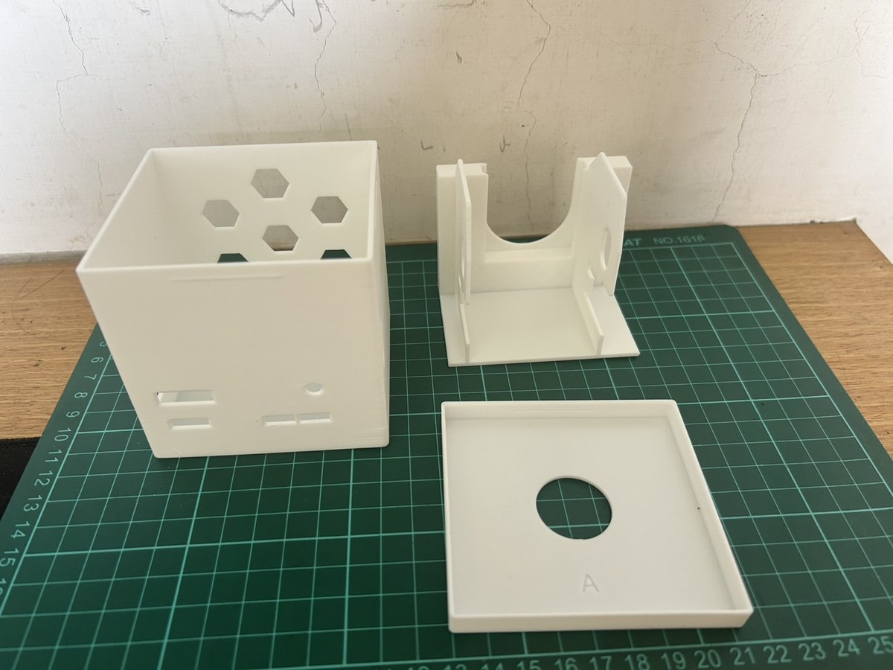<br><sub>三個零件</sub></td><td width="33%">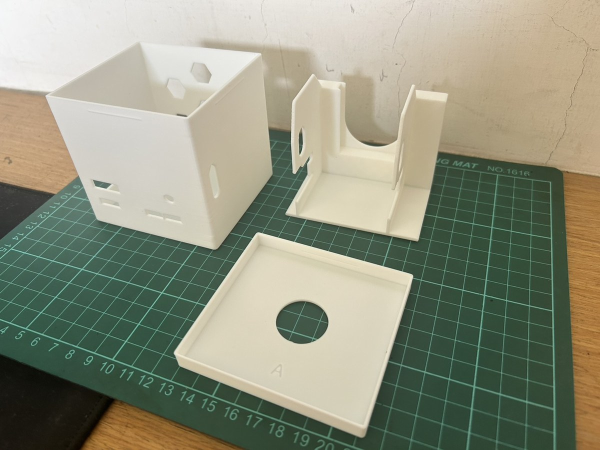<br><sub>三個零件,另一個角度</sub></td></tr>
  <tr><td width="33%">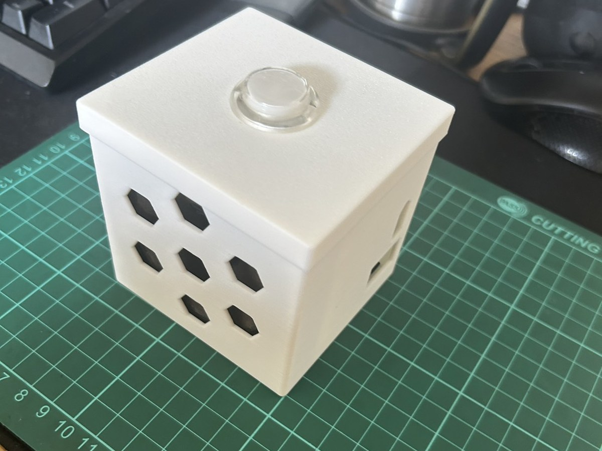<br><sub>放在桌上</sub></td><td width="33%">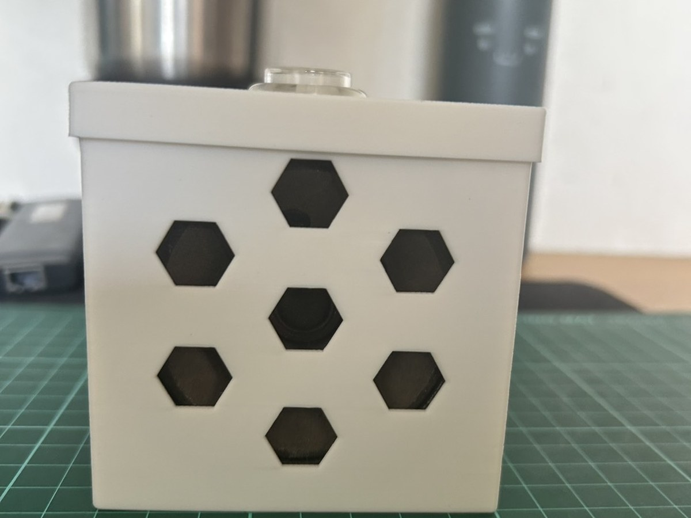<br><sub>喇叭面,放在桌上</sub></td></tr>
</table>

## 配合與公差

尺寸是從原廠紙盒量出來的,並在一台印表機上調過。如果你的印表機印出來的孔或外形大小不同,請修改 `src/aiy_case.py` 裡的這幾個常數:

- `HOLE_GRIP`:每個開孔額外加大的量(預設 0.2 mm)。
- `LID_GAP_VARIANTS`:頂蓋的鬆緊。變體 **A**(0.0 mm)是試印過、正式發布的頂蓋;
  變體 **B**(0.3 mm)比較鬆,**沒有試印過**,A 在你的印表機上太緊時可以試試。

## 重建與修改

需要 [uv](https://docs.astral.sh/uv/)(Python 3.11–3.14)。

```sh
uv run python src/aiy_case.py      # 殼身 + 頂蓋 A/B -> src/build/
uv run python src/aiy_holder.py    # 支架            -> src/build/
uv run python src/assembly.py      # 組裝 STEP       -> src/build/
```

使用 `build123d==0.13.0`(鎖在 `uv.lock`)時,重建出來的 STL 和 `models/` 裡的逐位元組相同。
程式註解是繁體中文,每個常數都註明了數值的來源。

## 授權

| 內容 | 授權 |
|---|---|
| 程式碼(`src/`、`pyproject.toml`) | [MIT](LICENSE) |
| 模型(`models/`)、圖片(`docs/`)與說明文件 | [CC BY 4.0](LICENSE-CC-BY-4.0.txt) |

可以列印、販售列印成品、修改與再散布,只要標明出處即可
(例如「Case for AIY Voice Kit v2 by YongRui0402」,並附上這個 repo 的連結)。
